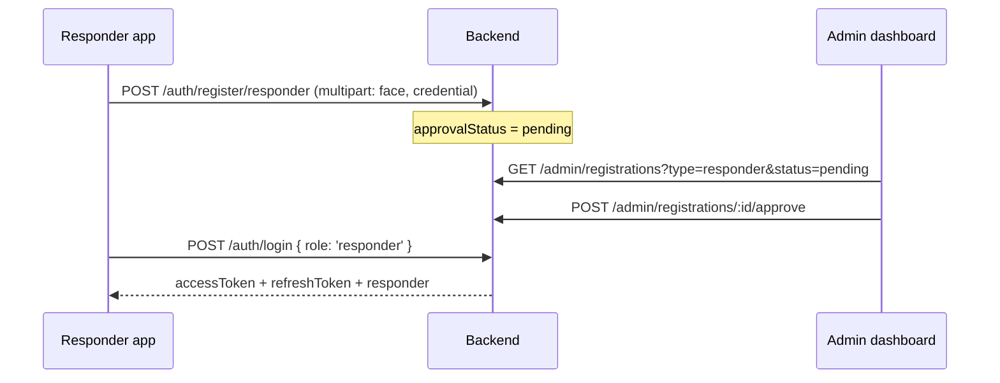
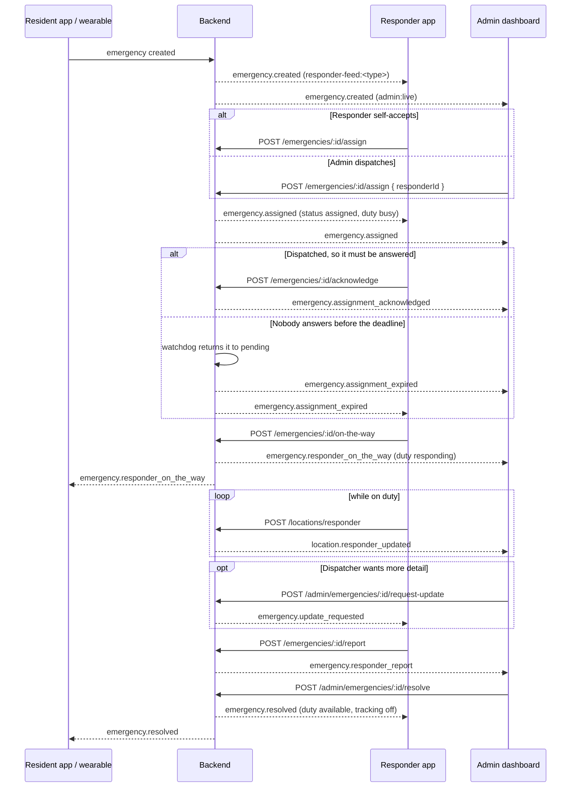
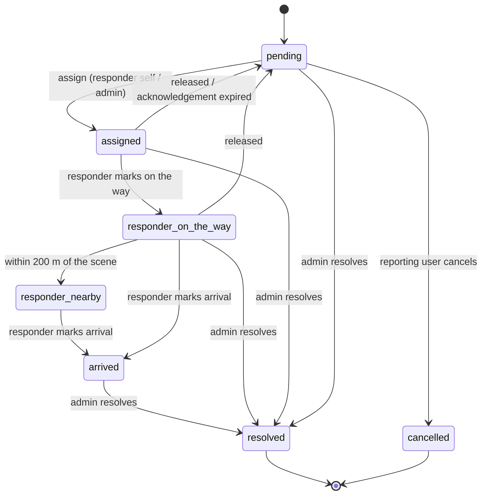
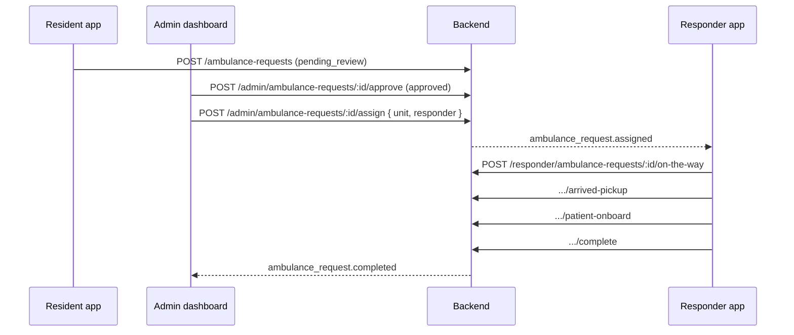

# TanzAlert responder flow

How the responder app works end to end, and where the web admin dashboard sits in that
flow. Everything here is read from the code; file references point at the authority for
each claim. The last section lists the places where the three parts do not yet line up.

**The three parts**

| Part | Lives in | Talks to the backend as |
|---|---|---|
| Responder app (Flutter, Android) | `MobileAppFlutter/mobileResponder` | role `responder` |
| Backend (Express + MongoDB + Socket.IO) | `backend/src` | — |
| Admin dashboard (React) | `web/src` | role `admin` |

The responder app and the dashboard never talk to each other. Every interaction between a
responder and a dispatcher goes through the backend: an HTTP call writes to the incident,
and a Socket.IO event tells the other side it happened.

---

## 1. Account lifecycle

A responder account cannot be used until an admin lets it in.

- **Register** — `registration_screen.dart` collects name, email, password, badge ID,
  department, and optionally agency type, station, position, coverage area, a face capture
  and a credential photo. Sent as multipart to `/auth/register/responder`
  (`auth_repository.dart:38`).
- **Pending** — until approval the router holds the app on `/pending`
  (`app_router.dart:38`), which is the only screen a pending account can reach.
- **Approve or reject** — the dashboard's Approvals page posts
  `/admin/registrations/:id/approve` or `/reject` with a required reason
  (`ApprovalsPage.tsx:50`). An admin can also create a responder outright from the
  Responders page (`POST /admin/responders`, `RespondersPage.tsx:114`).
- **Login** — `/auth/login` with `role: 'responder'`. Tokens go to
  `flutter_secure_storage`; the responder JSON is cached so a restart can restore a session
  offline. "Remember me" is enforced on restore: without it, stored tokens are discarded
  (`auth_repository.dart`, `restoreSession`).
- Assignment refuses any responder who is not approved —
  `RESPONDER_NOT_APPROVED`, `emergencies.service.ts:355`.

---

## 2. Session, transport, and rooms

Every authenticated request carries `Authorization: Bearer <access token>`; a 401 triggers
one refresh against `/auth/refresh` and a replay of the original request
(`core/networking/api_client.dart`).

The same token is handed to Socket.IO as `auth.token`. On connect the backend reads it and
joins rooms by role (`backend/src/server.ts:29`):

| Role | Rooms joined |
|---|---|
| user | `user:<id>` |
| responder | `responder:<id>`, plus `responder-feed:<type>` for every type their role covers |
| admin | `admin:live` |

Anyone can additionally `join:emergency` for one incident room (`emergency:<id>`).

The responder app holds **one socket for the session** (`core/realtime/incident_socket.dart`),
connected when the responder signs in rather than when a particular screen opens. It used to
belong to the live-map screen, which meant a dispatcher's message arrived only if that tab
happened to be open and went nowhere otherwise. Incoming messages now surface as a snackbar
on whatever tab is showing, and the incident channel refreshes itself while open.

`emitEmergencyEvent` (`modules/emergencies/events.ts`) publishes each incident event to the
admin room, the reporting user's room, the incident room, the type feed room, and the
assigned responder's own room — so a dispatcher watching the dashboard and a responder
holding the phone learn the same fact at the same moment.

> The app's API base address is resolved at runtime (`core/config/server_config.dart`) and
> re-discovered on the local network when the backend moves
> (`core/config/server_discovery.dart`). Nothing in this document depends on which address
> is in use.

---

## 3. Duty state

Duty is what makes a responder visible and dispatchable on the admin side.

- The Duty tab toggles it: `POST /responders/duty { status }`, and starting duty also
  starts the GPS broadcast (`duty_status_screen.dart:49`, `duty_provider.dart:22`).
- The app only ever sends `on_duty` or `off_duty`. The backend accepts a wider set
  (`off_duty`, `on_duty`, `busy`, `available`, `responding`, `inactive`, `unavailable`,
  `offline` — `locations.routes.ts:16`) and **moves the responder through the rest by
  itself**:

| Moment | dutyStatus becomes | Set by |
|---|---|---|
| Incident assigned to them | `busy` | `emergencies.service.ts:391` |
| They mark on-the-way | `responding` | `emergencies.service.ts:432` |
| Admin resolves the incident | `available` | `emergencies.service.ts:630` |

Each of those writes emits `responder.status_updated` to `admin:live`, which the dashboard
map consumes live (`MapPage.tsx:247`).

**Location** — while on duty, `LocationService` streams positions every 10 m of movement to
`POST /locations/responder`, optionally tagged with the incident or ambulance request being
served (`location_sharing/service/location_service.dart`). The backend stores the last 100
fixes per responder and emits `location.responder_updated` to `admin:live`
(`locations.service.ts:125`). The dashboard reads the roster from
`GET /responders/locations/live` and then follows the socket.

---

## 4. The incident flow

### Who may do what

| Step | Actor | Call | Guard |
|---|---|---|---|
| See the feed | responder | `GET /emergencies/active?type=` | role-filtered server-side |
| See my closed calls | responder | `GET /emergencies/history` | only incidents assigned to them and since resolved |
| Open one | responder | `GET /emergencies/:id` | assigned, or type within role |
| Accept | responder | `POST /emergencies/:id/assign` | status must be `pending`; type within role |
| Assign / reassign | admin | `POST /emergencies/:id/assign { responderId }` | any approved responder, any open status |
| Acknowledge | responder | `POST /emergencies/:id/acknowledge` | must be the assignee; idempotent |
| Hand back | responder | `POST /emergencies/:id/release` | must be the assignee |
| Take back | admin | `POST /emergencies/:id/release` | any assigned incident |
| On the way | responder | `POST /emergencies/:id/on-the-way` | must be the assignee, status `assigned` |
| Arrived on scene | responder | `POST /emergencies/:id/arrived` | must be the assignee, already moving; idempotent |
| Say something | all three | `POST /emergencies/:id/message` | responder must be the assignee; `audience` decides who reads it |
| Field report | responder | `POST /emergencies/:id/report` | must be the assignee, incident open |
| Request an update | admin | `POST /admin/emergencies/:id/request-update` | endpoint kept for older incidents; the dashboard now asks on the channel instead |
| Resolve | **admin only** | `POST /admin/emergencies/:id/resolve` | incident still open |

A responder can never close an incident. That is deliberate: `resolve` refuses any role but
admin (`emergencies.service.ts:595`).

A responder may only take what nobody is holding — self-accept still requires `pending`. A
dispatcher may take an incident off whoever holds it, which is the only way a stalled one
ever reaches somebody else.

### The sequence

### Status machine

`responder_nearby` and `arrived` exist in the status union and in `ACTIVE_STATUSES`
(`emergencies.service.ts:130`) but nothing sets them — see §8.

### When nobody answers

Two situations mean help is not coming while every screen says it is, and neither one
produces a button press from anybody. `dispatch.watchdog.ts` sweeps for both every
`DISPATCH_SWEEP_SECONDS` (default 20):

| Sweep | Condition | What happens |
|---|---|---|
| Unanswered assignment | status `assigned`, no `assignmentAckAt`, past `assignmentDeadlineAt` | returns to `pending`, assignee cleared, duty back to `available`, `emergency.assignment_expired` |
| Unclaimed incident | status `pending`, no assignee, older than `DISPATCH_OVERDUE_SECONDS` | `dispatchOverdueAt` set, `emergency.dispatch_overdue` raised to dispatch |

Accepting from the feed is its own acknowledgement and sets `assignmentAckAt` immediately.
A dispatcher's assignment does not: assigning a phone in someone's pocket is not the same
as assigning a person, so it carries a deadline (`DISPATCH_ACK_SECONDS`, default 90) until
the responder answers. An expired assignment is returned to the pool rather than flagged,
because a flagged assignment still reads as handled on every screen.

Both notify dispatch at `high` priority, and both raise the incident on the Dispatch page.

### When it closes

Only a dispatcher resolves an incident, and the responder has to be told rather than left
to notice. On `emergency.resolved` the app says so in a snackbar, drops the incident from
the live feed, and closes the detail sheet if that is what the responder is looking at —
buttons that no longer do anything are worse than no buttons.

The call then appears under **History**, the responder's fifth tab: incidents they were
assigned to and that were resolved, newest first, with their own field report attached. The
feed is for what is happening; this is the record of what they did.

### The incident channel

A field report is a document written afterwards. The channel is for the minutes while it
still matters, and every line on it carries an audience:

| `audience` | Who reads it | Default for |
|---|---|---|
| `dispatch` | dispatcher + assigned responder | responder and admin messages |
| `all` | the above **and the person who raised the alert** | everything the resident sends |

The split is the point. *"Scene not secure, hold back"* has to be said and would be
terrifying to read about yourself; *"I am at the scene"* is reassurance and belongs to them.
Reaching the resident is therefore a deliberate act — a switch on the responder's composer,
a checkbox on the dispatcher's — and never the default.

Dispatch-only notes are filtered out server-side before the resident's app sees the incident
(`withoutInternalNotes`), not hidden by the client, because that app can read the whole
record.

Both ends have one-tap updates rather than only a text box: `on_scene`, `need_backup`,
`transporting`, `scene_unsafe` and the rest on the responder side
(`core/constants/incident_updates.dart`); "Status?", "ETA?", "Help is close" on the
dispatcher's. The `code` travels with the message, so every screen renders the same words
for the same update. A dispatcher's quick reply follows the same "also tell the resident"
checkbox as a typed one — the chip sends immediately, to the responder always and to the
resident only when that box is ticked.

### Nearly there, without pressing anything

A responder on their way is already streaming position against the incident, so the system
works out the last part itself: once a fix lands within `RESPONDER_NEARBY_METERS` (200 m by
default) of the scene, the incident moves to `responder_nearby` and
`emergency.responder_nearby` goes out — to the resident above all, who is the one watching
the door. It fires once, because the status only moves out of `assigned` or
`responder_on_the_way`, so a responder circling the block cannot send the same promise five
times. An incident with no fix yet has nothing to be near and is left alone
(`locations.service.ts`, `flagResponderNearby`).

### After arrival: where do we take them?

Marking **Arrived on scene** does two things. It writes the timestamp a response time should
actually be measured to — `assigned` says somebody answered and `responder_on_the_way` says
they set off, and neither is help arriving — and it opens **Nearest facilities**: a map of
hospitals, Red Cross chapters, fire and police stations around the scene, opening on the kind
this emergency usually ends at (medical → hospital). Tapping a pin gives its distance and
hands off to turn-by-turn navigation.

The lookup is the `tanzalert_facilities` package, shared with the resident app so both find
the same places by the same rules: OpenStreetMap through Overpass with mirror rotation, a
bundled offline baseline so the map is never empty, and per-tile caching.

### What the responder sees

The **Live Map** tab (`emergency_map_screen.dart`) holds the feed: incident pins coloured by
type, filter chips for Medical / Crime / Fire / SOS, a connection dot driven by the socket,
and a bottom sheet per incident with:

- type, priority, status, barangay, reporter snapshot, reported time;
- the location, or **"Waiting for GPS — device still searching"** when a hardware panic
  button has not landed its first fix;
- device ID and battery at trigger for wearable-sourced incidents;
- an amber **"Admin requested an update"** card carrying the dispatcher's message, read
  from the `admin_update_requested` timeline entry (`emergency_map_screen.dart:600`);
- **Route to scene** — disabled until there is a real fix, so no one is routed to a
  placeholder coordinate; it opens an OSM map and hands off to Google Maps for turn-by-turn
  (`route_guidance_screen.dart:21`);
- **Accept Emergency** — only when the type is inside their role;
- **Acknowledge — I am taking this** — on a dispatcher's assignment they have not answered
  yet, with a note that dispatch takes it back automatically if nobody does;
- **Can't take this / Release to dispatch** — hands the incident back to the pending pool,
  with an optional reason ("already on another call") that tells the dispatcher whether to
  send the next-nearest unit or chase this one;
- **On the way** — only on their own assignment;
- **Submit field report** — situation on arrival, actions taken, optional note to admin,
  concatenated into one note (`report_form_screen.dart`).

The feed is filtered twice over: the backend returns only incidents whose type the
responder covers *or* that are assigned to them (`emergencies.service.ts:180`), and the app
drops anything out of role again when a socket event arrives
(`emergency_map_screen.dart:126`).

### Role rules

`allowedEmergencyTypes` is derived from `responderRole`, `department` and `agencyType`
(`responder_model.dart:70`) — e.g. BFP/fire → `fire`, PNP/police → `crime`,
medical → `medical`, MDRRMO/rescue/barangay → `general_sos`.

- **Feed visibility** is permissive: a responder with *no* configured role sees everything
  (`canHandleEmergencyType`).
- **Self-accept** is strict: it requires an explicit role match (`canSelfAssign`). Out of
  role, the sheet shows *"Outside your role — only admin can assign this to you."* and the
  backend independently refuses with `OUT_OF_ROLE` (`emergencies.service.ts:364`).
- An **admin assignment overrides role entirely** — the admin branch of `assign` skips the
  role check. This is the intended escape hatch when the right unit is not the obvious one.

---

## 5. Ambulance transport — a second, separate pipeline

Ambulance requests are not incidents. They have their own model, routes, statuses and
screens, and a responder never self-assigns one: **dispatch is admin-only**.

Each step is a strict transition from the previous status — `on_the_way` only from
`assigned`, `arrived_pickup` only from `on_the_way`, and so on
(`ambulance.service.ts:555`). The Ambulance tab lists only this responder's assignments
(`GET /responder/ambulance-requests`), and opening one starts the location broadcast tagged
with `ambulanceRequestId` (`ambulance_detail_screen.dart:132`). The dashboard's Ambulance
page picks the unit and the responder from approved, active responders and follows
`ambulance_request.*` events live (`AmbulanceRequestsPage.tsx:157`).

---

## 6. Where the dashboard watches the responder

| Dashboard page | Reads | Acts |
|---|---|---|
| **Incidents** | `/emergencies/active`, incident events | message the channel, release, resolve |
| **Dispatch** | `/emergencies/active`, `/responders/locations/live` | assign, reassign, release to the pool |
| **Map Center** | both of the above + `location.responder_updated`, `responder.status_updated` | — (live picture) |
| **Responders** | `/admin/registrations?type=responder` | create responder accounts |
| **Approvals** | `/admin/registrations` | approve / reject registrations |
| **Ambulance** | `/admin/ambulance-requests` | approve, reject, assign unit + responder |
| **Audit** | `/admin/audit` | — |

Every responder action also writes an `AuditLog` row — `emergency.assigned`,
`emergency.on_the_way`, `emergency.report_filed`, `ambulance_request.*` — with actor, IP,
user agent and request ID, which is what the Audit page reads.

Admin notifications are raised from the same event stream
(`notifications.service.ts`), delivered to `admin:live` as `admin_notification.created`.

---

## 7. Event reference

Emitted by the backend and consumed as marked (R = responder app, A = admin dashboard,
U = resident app):

| Event | Raised when | R | A | U |
|---|---|:-:|:-:|:-:|
| `emergency.created` | resident raises an alert | ✓ | ✓ | ✓ |
| `emergency.iot_device_created` | wearable raises an alert | ✓ | ✓ | ✓ |
| `emergency.location_updated` | a new fix lands on an open incident | ✓ | ✓ | ✓ |
| `emergency.updated` | incident edited | ✓ | ✓ | ✓ |
| `emergency.assigned` | self-accept or admin dispatch | ✓ | ✓ | ✓ |
| `emergency.assignment_acknowledged` | responder answers a dispatch | ✓ | ✓ | — |
| `emergency.assignment_expired` | watchdog reclaims an unanswered assignment | ✓ | ✓ | — |
| `emergency.released` | responder or dispatcher hands it back | ✓ | ✓ | — |
| `emergency.dispatch_overdue` | nobody accepted in time | ✓ | ✓ | — |
| `emergency.responder_on_the_way` | responder starts moving | ✓ | ✓ | ✓ |
| `emergency.responder_nearby` | responder's own position lands within 200 m | ✓ | ✓ | ✓ |
| `emergency.responder_arrived` | responder marks arrival on scene | ✓ | ✓ | ✓ |
| `emergency.message` | anyone writes on the incident channel | ✓ | ✓ | ✓ |
| `emergency.responder_report` | field report filed | ✓ | ✓ | — |
| `emergency.update_requested` | admin asks the assignee for an update | ✓ | ✓ | — |
| `emergency.user_message` | reporting resident sends a message | — | ✓ | ✓ |
| `emergency.resolved` | admin closes the incident | ✓ | ✓ | ✓ |
| `responder.status_updated` | duty status changed | — | ✓ | — |
| `location.responder_updated` | responder position ingested | — | ✓ | — |
| `ambulance_request.*` | transport pipeline steps | — | ✓ | ✓ |
| `admin_notification.created` | any notifiable event | — | ✓ | — |

---

## 8. Known gaps

Honest list of places where the parts do not line up. None of these break the main flow.

1. **`emergency.iot_keychain_created` is never emitted**, though all three clients
   listen for it and the notification service handles it.
2. **The duty toggle swallows its own errors.** `_syncDutyStatus` catches and discards
   everything (`duty_provider.dart:25`), so if the POST fails the switch still reads
   "on duty" while the dashboard shows the responder as off duty.
3. **The field report sends no `reportType`.** The app concatenates its three fields into
   one `note`; the backend accepts an optional `reportType` that nothing populates.
4. **A legacy socket relay remains.** `socket.on('responderLocation')` rebroadcasts to a
   room literally named `user` (`server.ts:118`) — no current client emits or listens to it.
5. **A stale web responder console is still in the tree.** `web/src/App.tsx`,
   `pages/ResponderLogin.tsx` and `pages/ResponderDashboard.tsx` are an older browser-based
   responder surface that nothing mounts — `web/src/main.tsx` renders `app/App.tsx`, the
   admin dashboard. It even keeps its own token under a different key (`responderToken`).
   Dead code, but it reads as a second responder client if you go looking.
6. **Report deduplication is time-based.** An identical note from the same responder within
   10 s is silently dropped and the existing incident returned
   (`emergencies.service.ts:454`) — a retry after a network blip is safe, but a genuine
   repeated note inside that window is lost.

---

## 9. File map

| Concern | Responder app | Backend | Dashboard |
|---|---|---|---|
| Routing / shell | `core/routing/app_router.dart` | `app.ts` | `components/layout/Sidebar.tsx` |
| Auth | `features/auth/**` | `modules/auth/**` | `features/auth/**` |
| Duty + location | `features/duty_status/**`, `features/location_sharing/**` | `modules/locations/**` | `features/map/MapPage.tsx` |
| Incidents | `features/emergency_map/**` | `modules/emergencies/**` | `features/incidents`, `features/dispatch` |
| Field reports | `features/response_reports/**` | `emergencies.service.ts` (`report`) | `features/incidents/IncidentsPage.tsx` |
| Incident channel | `features/incident_thread/**` | `emergencies.service.ts` (`sendMessage`) | `features/incidents/IncidentsPage.tsx` |
| Nearest facilities | `features/facilities/**` + `packages/tanzalert_facilities` | — | — |
| Response history | `features/history/**` | `emergencies.service.ts` (`listResolvedForResponder`) | — |
| Dispatch watchdog | — | `modules/emergencies/dispatch.watchdog.ts` | `features/dispatch/DispatchPage.tsx` |
| Ambulance | `features/ambulance_assignments/**` | `modules/ambulance/**` | `features/ambulance_requests/**` |
| Realtime | `emergency_map_screen.dart` (`_connectSocket`) | `server.ts`, `modules/emergencies/events.ts` | `services/socketClient.ts` |
